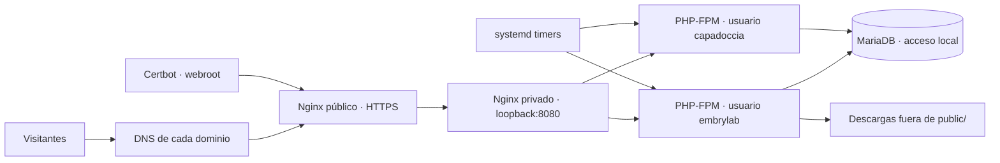

# WordPress VPS Migration

**Autor: Daniel — [@budatecnik](https://github.com/budatecnik)**

Preparación de un VPS Ubuntu y migración de **EmbryLab** y **Capadoccia Tour**
desde hosting compartido de Zomro a un VPS de InterServer. El proyecto documenta
las decisiones, el traslado de archivos y bases de datos, las pruebas privadas,
el cambio de DNS, HTTPS y la recuperación ante fallos.

**Resultado del caso real, al 26 de noviembre de 2026:** ambos sitios publicados
en el VPS con HTTPS y tareas programadas. La entrega externa de correo de
EmbryLab sigue pendiente del desbloqueo SMTP del proveedor. No se presenta como
una tienda completamente validada para ventas.

> Este repositorio es una versión preparada para publicación: contiene
> documentación, herramientas y plantillas sin datos de clientes ni secretos.
> No contiene una copia de las webs, del editor ni de las bases de datos.

## El problema

Mover dos sitios con necesidades distintas a un servidor de recursos limitados:

| Sitio | Necesidad principal | Riesgo que había que controlar |
|---|---|---|
| EmbryLab — `embrylab.com` | WordPress, WooCommerce y productos digitales | Conservar archivos privados, permisos y referencias de descarga |
| Capadoccia Tour — `cappadociatour.help` | WordPress y páginas en varios idiomas | Mantener navegación, recursos y URLs |

La preparación se hizo sobre un **VPS existente**, con aproximadamente 1 vCPU,
2 GiB de RAM, 1 GiB de swap y 38 GB de disco. Se preservaron los datos y
respaldos de una carga anterior. La contratación y creación del VPS en el panel
del proveedor fueron manuales; este proyecto no afirma aprovisionarlo mediante
Terraform ni una API.

## Arquitectura utilizada



Nginx, PHP-FPM 8.3 y MariaDB se ejecutan de forma nativa. Se eligió esta
arquitectura para mantener una operación sencilla y medir el uso de memoria;
Docker no fue necesario para este caso. Cada sitio tiene usuario, directorio y
pool PHP propios. Esto reduce el acoplamiento, pero **no equivale al aislamiento
de dos máquinas virtuales**.

## Qué se realizó

1. Auditoría de servicios, puertos, firewall, almacenamiento y respaldos.
2. Preparación del stack y de usuarios y pools PHP por sitio.
3. Exportación de bases de datos y copia de archivos mediante SSH y rsync.
4. Verificación de integridad, incluidos los archivos privados de WooCommerce.
5. Restauración en copias privadas, con cron, correo y pagos controlados.
6. Adaptación de rutas y pruebas HTTP antes del cambio de DNS.
7. Publicación de ambos dominios, certificados y temporizadores de WordPress.
8. Configuración del correo de EmbryLab y diagnóstico de una restricción SMTP.

Como extensión posterior se publicó un editor estático de pruebas protegido por
contraseña en `/staging/editor/`. Su código permanece en su repositorio separado.

## Recorrido del proyecto

| Documento | Contenido |
|---|---|
| [Contexto y alcance](docs/01-contexto-y-alcance.md) | Objetivos, responsabilidades y límites |
| [Arquitectura](docs/02-arquitectura.md) | Servicios, directorios, permisos y decisiones |
| [Migración](docs/03-migracion.md) | Backup, copia, restauración privada y cutover |
| [Operación y rollback](docs/04-operacion-y-rollback.md) | Recuperación, cron, TLS y respaldos |
| [Validaciones](docs/05-validacion.md) | Evidencias históricas y pruebas del repositorio |
| [Estado y limitaciones](docs/06-estado-y-limitaciones.md) | Lo completado y lo que sigue pendiente |
| [Publicación en GitHub](docs/07-publicacion-github.md) | Preparar y publicar este proyecto sin datos privados |
| [Referencias](docs/08-referencias.md) | Documentación técnica primaria |

## Uso local de las herramientas

Requisitos: Python 3.12 o posterior y Bash. La copia necesita rsync y un cliente
OpenSSH; la exportación necesita un cliente MySQL o MariaDB en el host de origen.

```bash
cp config/inventory.example.json config/config.local.json
# Editar config/config.local.json; nunca añadirlo a Git.
python3 scripts/migrate_files.py --config config/config.local.json --site embrylab
```

El último comando **solo muestra un plan**. Para ejecutar una copia es necesario
seleccionar `--mode copy --apply`; la verificación utiliza rsync con checksum y
dry-run. Ninguna herramienta crea bases de datos, cambia DNS ni reinicia servicios
de forma automática.

```bash
# Genera plantillas en una carpeta privada, sin instalarlas.
python3 scripts/render_templates.py --config config/config.local.json \
  --site embrylab --output private/rendered/embrylab

# Comprobaciones del repositorio: no necesitan acceso al VPS.
make check
make test
make package
```

Las plantillas representan la arquitectura del caso. **No son un instalador
universal**: requieren revisar versiones, usuarios, sockets, permisos y la
configuración existente antes de instalarlas.

## Alcance de las pruebas

El repositorio comprueba configuración, generación de comandos, controles de
copia, manejo de credenciales y manifiestos con datos sintéticos. Su CI no
accede al servidor ni demuestra la entrega de correo o el funcionamiento de
pagos. Las comprobaciones del caso real se describen por separado y con sus
limitaciones.

## Autoría y contenido excluido

Proyecto preparado por Daniel para su portafolio técnico. No se distribuyen
WordPress, plugins, temas comerciales, diseños de bordado ni el código del
editor. Las herramientas usan interfaces de proyectos externos, cuya
documentación y licencias son independientes. No se ha asignado todavía una
licencia de redistribución a este repositorio.
